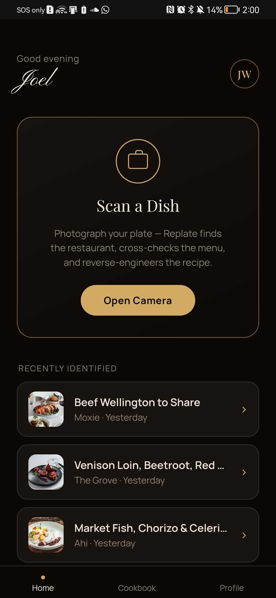
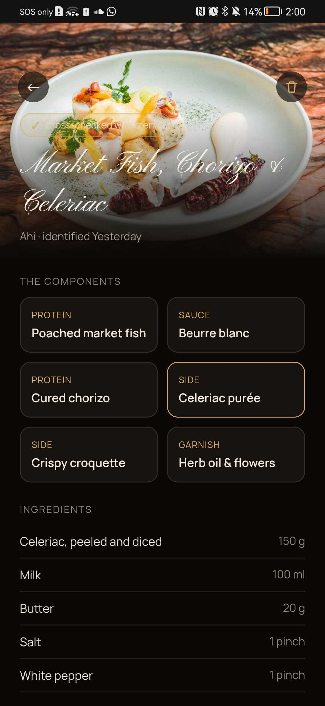
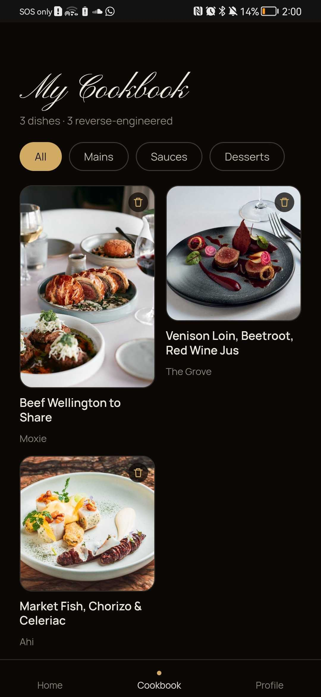
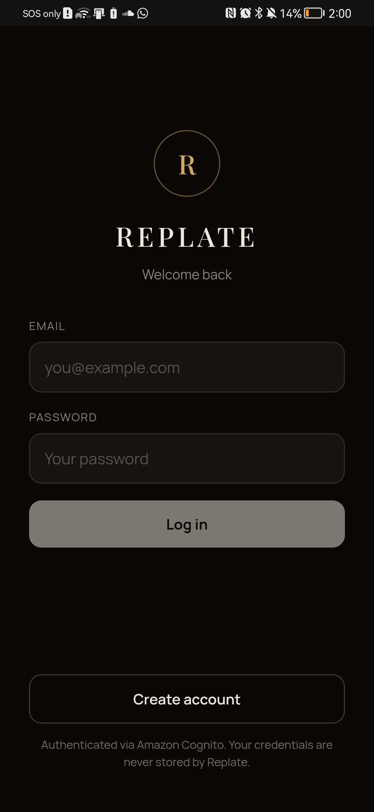

# Replate

The idea behind this app is that when a user is at a restaurant they would be able to take a
photo of their meal, AI would analyze the photo and essentially give you back the full method to
make each element on the dish and recreate it at home. Essentially a Shazam for restaurant
dishes.

It works in two steps, on purpose. Snapping the photo **identifies** the dish — it finds the
restaurant from your location, fetches that restaurant's real menu, and matches the photo
against it (this match is what keeps the AI honest). The dish is saved straight to your
cookbook. Then, whenever you actually want to cook it, you open it and hit **Reverse engineer**
to get the per-component ingredients and method. Generating that recipe is the slow, expensive
part, and nobody needs it while they're still sitting at the table.

## Live deployment

**https://d8j5itd2nds9.cloudfront.net/home** — the React site, served from CloudFront
(stack `replate`, region `ap-southeast-2`).

> **Status:** live and real. Real Cognito auth, real AWS infrastructure, and real Anthropic
> Claude calls (`claude-sonnet-5`) for both the vision identification and the "Reverse engineer"
> recipe generation (the key is read from SSM Parameter Store at runtime). Deploys are automated:
> merging to `main` runs GitHub Actions that `sam deploy` the stack and publish this site, and
> every PR runs the backend + frontend test suites; the Playwright e2e suite is run manually.
> The remaining work is Phase 6 (real technique embeddings — a pseudo-embedding stub for now)
> and image moderation, which stays off (`ModerationEnabled=false`) and should be switched on
> before uploads open to the public. See [`infra/README.md`](infra/README.md) for the CI/CD setup.

## Screenshots

<table>
  <tr>
    <td width="50%" valign="top">
       
      <b>Home</b> — scan a dish, plus your recently identified plates.
    </td>
    <td width="50%" valign="top">
       
      <b>Reverse-engineered recipe</b> — per-component breakdown with ingredients and method, cross-checked against the restaurant's menu.
    </td>
  </tr>
  <tr>
    <td width="50%" valign="top">
       
      <b>Cookbook</b> — every dish you've identified, saved automatically.
    </td>
    <td width="50%" valign="top">
       
      <b>Sign in</b> — Amazon Cognito authentication.
    </td>
  </tr>
</table>

## Where things are

| | |
|---|---|
| [`backend/`](backend/README.md) | Python on AWS Lambda + Step Functions — run it locally against LocalStack |
| [`frontend/`](frontend/README.md) | React (Vite + TypeScript), mobile-first — `npm run dev` |
| [`infra/`](infra/README.md) | AWS SAM template for the production environment, deployed by GitHub Actions on merge to `main` |
| [`docs/`](docs/) | [API reference](docs/api.md), [architecture](docs/architecture.md), [user flow](docs/user-flow.md), and the [decision log](docs/decisions.md) |
| [`CLAUDE.md`](CLAUDE.md) | Project rules and the phase-by-phase build plan |

> **On AWS since 2026-08-14.** Replate was originally built on Azure and was ported before
> anything had been deployed, so the move cost no data and no downtime. See
> [`docs/decisions.md`](docs/decisions.md) for the reasoning, and the git history before
> `77f091a` for the Azure version.
