# Azure Target Architecture

This is the **Phase 3 target** architecture from `CLAUDE.md` — what Replate deploys to once
infra work starts. Nothing here is provisioned yet: Phase 1 (backend) and Phase 2 (frontend)
are built and run entirely against local emulators (Azurite, a local SQL Server, mocked
auth). This diagram is the destination, not the current state.

```mermaid
flowchart TB
    subgraph Client["Client"]
        Browser["React SPA (mobile-first)<br/>MSAL for auth"]
    end

    subgraph Identity["Identity"]
        EntraID["Microsoft Entra External ID<br/>(SPA + API app registrations)"]
    end

    subgraph Hosting["Frontend Hosting"]
        SWA["Azure Static Web Apps<br/>(React build)"]
    end

    subgraph Compute["Compute"]
        FuncApp["Azure Functions<br/>(Consumption / Flex Consumption)<br/>HTTP triggers + Durable Functions orchestrator"]
    end

    subgraph Storage["Storage"]
        StorageAcct["Storage Account<br/>Blob: uploads container · Queue: jobs<br/>+ Durable Functions task hub state"]
    end

    subgraph Data["Data"]
        SQL["Azure SQL Database (free-offer tier)<br/>Jobs / Restaurants / MenuItems /<br/>JobResults / DishElements<br/>CulinaryEmbeddings (native VECTOR column)"]
    end

    subgraph Security["Security"]
        KeyVault["Key Vault<br/>LLM/API keys, Entra client secret"]
    end

    subgraph Realtime["Real-time"]
        SignalR["SignalR Service / Web PubSub<br/>(Free tier)"]
    end

    subgraph Moderation["Moderation (if in scope)"]
        ContentSafety["Azure AI Content Safety<br/>image moderation"]
    end

    subgraph External["External APIs (3rd-party, non-Azure)"]
        Places["Google Places / Yelp Fusion<br/>restaurant lookup"]
        WebSearch["Web search + fetch<br/>menu scraping/extraction"]
        Vision["Vision model<br/>Claude API or Azure OpenAI"]
        Embeddings["Embedding model<br/>culinary technique vectors"]
    end

    Browser -- "sign in (OIDC)" --> EntraID
    Browser -- "loads app" --> SWA
    Browser -- "POST /api/jobs, PUT photo (SAS),<br/>GET /api/jobs/{id} — bearer token" --> FuncApp
    Browser -- "job status push" --> SignalR

    FuncApp -- "validates token" --> EntraID
    FuncApp -- "SAS URLs, blob read/write, queue msg" --> StorageAcct
    FuncApp -- "reads secrets via Key Vault references" --> KeyVault
    FuncApp -- "reverse-geocode candidates" --> Places
    FuncApp -- "scrape + extract menu" --> WebSearch
    FuncApp -- "dish/element guess" --> Vision
    FuncApp -- "embed technique text" --> Embeddings
    FuncApp -- "moderate upload" --> ContentSafety
    FuncApp -- "read/write job + result rows,<br/>VECTOR_DISTANCE query" --> SQL
    FuncApp -- "push completion" --> SignalR
```

## Request flow (happy path)

1. Browser signs in via Entra External ID (MSAL), loads the React app from Static Web Apps.
2. `POST /api/jobs` (GPS) → Function App creates a `Jobs` row, returns a write-only SAS URL.
3. Browser `PUT`s the photo directly to Blob Storage with that SAS URL — never through the
   Function App.
4. A queue message starts the Durable Functions orchestrator: geocode → menu fetch (cached
   per restaurant) runs alongside the vision-model guess, then both join at the menu-match
   fan-in step (the anti-hallucination check), then the structured recipe generator runs,
   grounded by a `VECTOR_DISTANCE` lookup against `CulinaryEmbeddings`.
5. Result is persisted to Azure SQL; the client is notified via SignalR/Web PubSub instead of
   polling (Phase 1/2 poll `GET /api/jobs/{id}` locally as the seam for this).

## Resource free-tier notes (Global Rule 1 — re-verify before provisioning, pricing changes)

| Resource | Free tier (per CLAUDE.md) | Notes |
|---|---|---|
| Static Web Apps | Free tier available | Hosts the React build |
| Functions (Consumption/Flex Consumption) | Pay-per-execution, no fixed hourly cost | Plan choice TBD in Phase 3 — check current free grant |
| Storage Account | Pennies/GB, no free tier per se | Blob + Queue + Durable Functions state |
| Azure SQL Database | 100,000 vCore-seconds + 32 GB storage free/month, up to 10 free DBs/subscription | Set auto-pause on limit, not bill-overage |
| Entra External ID | 50,000 MAU free tier | Re-verify current limit |
| Key Vault | Pay-per-operation, negligible at this scale | No fixed hourly cost |
| SignalR / Web PubSub | Free tier (connection/message capped) | Note limits before relying on it at scale |
| AI Content Safety | Free tier available (if adopted) | Only if image moderation is in scope |
| Google Places/Yelp, vision model, embedding model, web search | Not Azure — billed per-call by their own providers | Budget separately; the recipe-generation call is expected to be the largest single cost/latency contributor |

## Deployment (Phase 4, not yet built)

Bicep modules per resource above, deployed manually first (`az deployment group create`),
then automated via GitHub Actions using OIDC federated credentials (no long-lived service
principal secret). See `CLAUDE.md` Phase 3/4 for the full sequencing.
