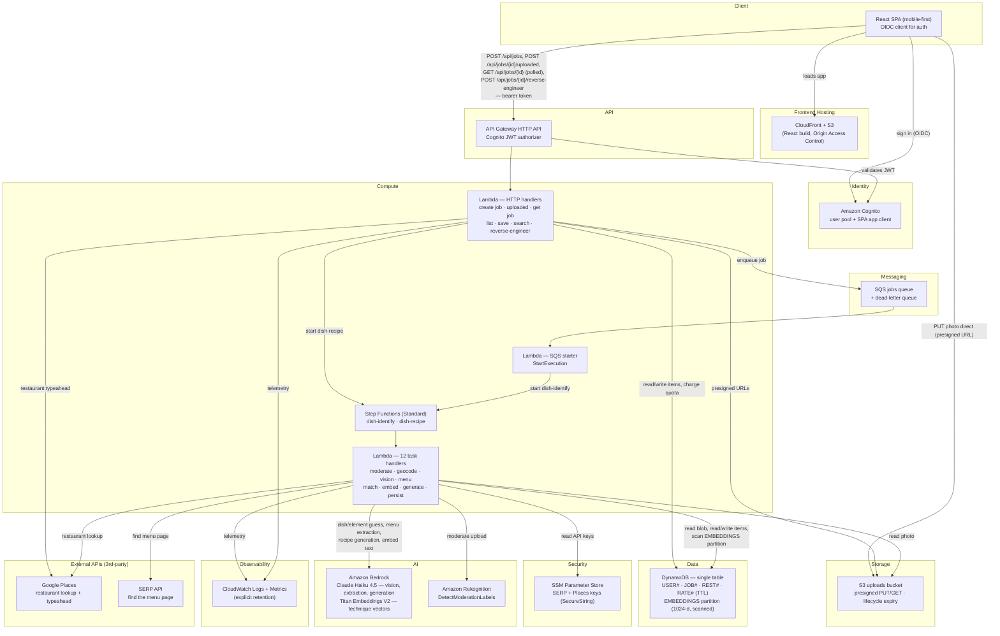

# AWS Target Architecture

The Phase 3 architecture for Replate. The Azure→AWS **port is complete** (Phase 0), and the
SAM template that provisions everything below now lives in `infra/template.yaml`. It is
being rolled out in two passes (see `docs/decisions.md`, 2026-08-14):

- **Phase 3a (current):** deploy the whole stack with the paid integrations stubbed — Bedrock
  model ids blank, Rekognition off, SERP/Places keys empty, embeddings left as the SHA-256
  pseudo-vector. Everything else — Lambda, API Gateway, Step Functions, DynamoDB, SQS, S3,
  CloudFront, Cognito, IAM, CloudWatch — is real. The pipeline runs end-to-end returning
  canned data, so it deploys, demos and tears down without a per-token bill.
- **Phase 3b:** fill in the real model calls, grant Bedrock model access, and load the two
  SERP/Places `SecureString` params.

The stack deploys to **`ap-southeast-2` (Sydney)**. The pre-migration Bicep is recoverable
from git history at commit `07354af`.

Three deviations from a by-the-book AWS design, all logged in `docs/decisions.md`:

- **No relational database and no vector index.** A single DynamoDB table holds everything,
  and the few hundred culinary-technique embeddings are scanned brute-force with numpy inside
  the Lambda. This is what the Azure design was already doing with an unindexed
  `VECTOR_DISTANCE` — it just moves from the database into the process.
- **Menu lookup is search → fetch → extract**, not one tool-using model call. Bedrock does not
  expose Anthropic's server-side `web_search` tool, so a third-party SERP API does the search.
- **No push channel.** The client polls `GET /api/jobs/{id}`; `useJobPolling.ts` remains the
  documented swap seam.

> No push channel: the client polls `GET /api/jobs/{id}` every 3 seconds.
> `frontend/src/lib/jobs/useJobPolling.ts` is the seam to swap if that changes — on AWS the
> alternatives are API Gateway WebSockets or AWS IoT Core over MQTT.

**Everything except Bedrock, Rekognition, Google Places and the SERP API authenticates via
IAM.** Only two stored credentials exist in the whole system — the SERP API key and the Google
Places key — and both live in Parameter Store as `SecureString` parameters. There is no VPC
and therefore no NAT Gateway, which is the most common way a nominally serverless AWS project
starts costing real money.

## Request flow (happy path)

The pipeline runs as **two separately-triggered Step Functions executions**, not one. Stage 1
is automatic; stage 2 only runs when the user asks for the recipe, because it is the most
expensive call in the pipeline and isn't wanted while the user is still at the restaurant —
see `docs/decisions.md`.

**Stage 1 — automatic, on upload:**

1. Browser signs in via Cognito, loads the React app from CloudFront.
2. `POST /api/jobs` (GPS or a manually-selected restaurant) → Lambda writes the job item,
   returns a **presigned PUT URL**, and charges the caller's scan quota. It deliberately does
   **not** enqueue anything: the photo does not exist yet.
3. Browser `PUT`s the photo directly to S3 with that presigned URL — never through Lambda.
4. `POST /api/jobs/{id}/uploaded` enqueues to SQS, now that there is an image to read.
5. The SQS message triggers the starter Lambda, which begins the `dish-identify` execution.
   First, and alone, `ModerateImage` gates everything below it, so a rejected photo costs one
   Rekognition call and no model spend. Then geocode (or select the chosen restaurant) → menu
   fetch (cached per restaurant) runs in a `Parallel` state alongside the vision-model guess,
   and both join at the menu-match step (the anti-hallucination check). The execution **stops
   there**.
6. `PersistMatchResult` writes the result item — including the raw vision guess, which stage 2
   needs as input — sets the job to `Identified` and marks it saved, putting the dish in the
   user's cookbook automatically. The client picks it up on its next poll of
   `GET /api/jobs/{id}`, which returns the matched dish and confidence badge with an empty
   `elements` array.

**Stage 2 — only when the user presses "Reverse engineer":**

7. `POST /api/jobs/{id}/reverse-engineer` charges the caller's separate recipe quota, sets the
   job to `Generating` and starts a `dish-recipe` execution.
8. A cosine-similarity scan over the `EMBEDDINGS` partition grounds the structured recipe
   generator, whose output is persisted as `ELEMENT#` items and the job set to `Completed`.
9. If generation fails the job reverts to `Identified` with an error message rather than
   `Failed`, so a transient model error doesn't discard a good menu match.

## Resource free-tier notes

Per Global Rule 5 — **re-verify all of this before provisioning; AWS pricing and free-tier
terms change.** The column that matters most is the middle one: AWS mixes *always-free*
monthly grants with 12-month trial grants, and the difference only shows up a year in.

| Resource | Free tier | Always-free or 12-month? | On overage | Fixed hourly cost |
|---|---|---|---|---|
| Lambda | 1M requests + 400k GB-s/month | **Always** | Per-request + per-GB-s | No |
| DynamoDB | 25 GB + 25 provisioned RCU + 25 WCU | **Always** | Per-RCU/WCU-hour — **on-demand tables are not covered at all** | No |
| SQS | 1M requests/month | **Always** | Per-request | No |
| Step Functions (Standard) | 4,000 state transitions/month | **Always** | Per-transition | No |
| CloudFront | 1 TB out + 10M requests/month | **Always** | Per-GB + per-request | No |
| CloudWatch Logs | 5 GB ingestion + 5 GB storage/month | **Always** | Per-GB ingestion — the sleeper cost; set retention | No |
| SSM Parameter Store (Standard) | Unlimited standard parameters | **Always** | — | No |
| Cognito | MAU-based free tier | **Always** | Per-MAU above the grant | No |
| S3 | 5 GB + 20k GET + 2k PUT/month | **12 months** | ~per-GB-month; lifecycle-expire uploads | No |
| API Gateway (HTTP API) | 1M requests/month | **12 months** | Per-million requests | No |
| Rekognition | 5,000 images/month | **12 months** | Per-image | No |
| Amazon Bedrock | **None** — pay per token | — | Per input/output token | No |
| Google Places | Provider-specific | — | Billed by Google | — |
| SERP API | Provider-specific (varies by vendor) | — | Per-query | — |

**Nothing in this design carries a fixed hourly cost**, provided DynamoDB stays on provisioned
capacity at or below 25 RCU/WCU, no VPC (and therefore no NAT Gateway) is introduced, and no
vector index service is added. That last one matters: OpenSearch Serverless has a minimum
billed capacity and would, on its own, cost more than everything else here combined.

**Most likely to actually cost money:** Bedrock token spend on the recipe generator (the
heaviest-output call in the pipeline), then CloudWatch log ingestion if retention is left at
the "never expire" default, then S3 storage once the 12-month grant lapses if uploads are
never expired.

Splitting the pipeline in two directly targets that first item: the generator no longer runs
on every uploaded photo, only on the dishes a user explicitly asks to reverse engineer. Stage
1 (vision guess + menu extraction) still runs per photo, so it remains the per-upload cost
floor. Note that Step Functions' 4,000-transition grant works out to roughly 500 scans a month
at ~7 transitions per stage-1 execution — comfortable at MVP scale, but it is the grant most
likely to bind first.

## Deployment

Infrastructure lives in `infra/` as an **AWS SAM** template — which is to say a CloudFormation
stack, since SAM is a template transform. Deployed manually with `sam build && sam deploy
--guided` in Phase 3; automating it via GitHub Actions with **OIDC federated credentials to an
IAM role** (no long-lived access keys) is Phase 4.

Two things the template cannot do, which stay manual:

- **Bedrock model access** must be granted per-model, per-region in the console before the
  first call.
- **Cognito's hosted-UI domain and the SPA callback URLs** need the CloudFront distribution
  domain, which doesn't exist until the first deploy — so the SPA client config is a two-pass
  step, exactly as the Entra app registration was.

Step Functions definitions live in standalone `.asl.json` files referenced by `DefinitionUri`,
rather than inline in the template, so they stay readable and diffable on their own.
