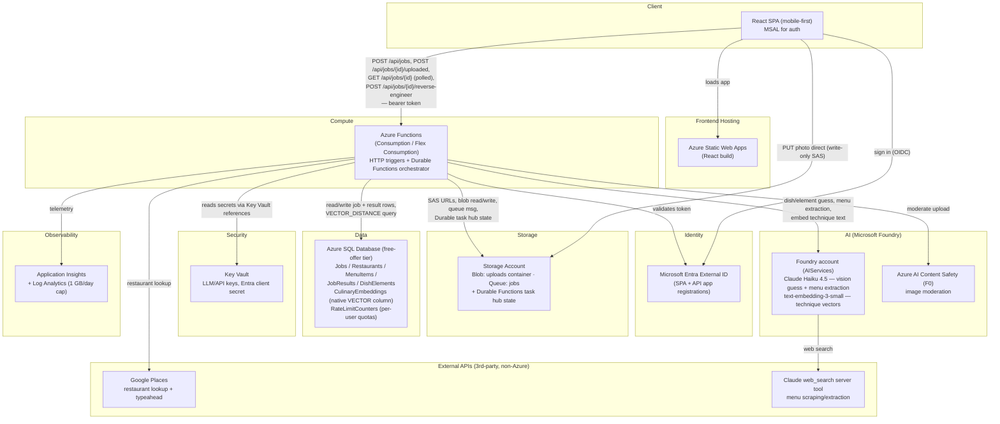

# Azure Target Architecture

The Phase 3 architecture for Replate. **The Bicep for everything below is written and lives
in `infra/`, but has not been deployed yet** — Phase 1 (backend) and Phase 2 (frontend) still
run entirely against local emulators (Azurite, a local SQL Server, mocked auth). See
`infra/README.md` for the deploy sequence and the manual prerequisites.

Two deviations from the original CLAUDE.md resource list, both logged in `docs/decisions.md`:

- **AI models come from Microsoft Foundry**, not the first-party Anthropic API or Azure
  OpenAI vision — Claude Haiku 4.5 for the vision guess and menu extraction, plus Azure
  OpenAI `text-embedding-3-small` for culinary-technique vectors, both deployed on one
  Foundry account.
- **SignalR / Web PubSub is not provisioned.** The client polls `GET /api/jobs/{id}`;
  `useJobPolling.ts` remains the documented swap seam.

> No SignalR / Web PubSub: the client polls `GET /api/jobs/{id}` every 3 seconds.
> `frontend/src/lib/jobs/useJobPolling.ts` is the seam to swap if that changes.

## Request flow (happy path)

The pipeline runs as **two separately-triggered Durable orchestrations**, not one. Stage 1 is
automatic; stage 2 only runs when the user asks for the recipe, because it is the most
expensive call in the pipeline and isn't wanted while the user is still at the restaurant —
see `docs/decisions.md`.

**Stage 1 — automatic, on upload:**

1. Browser signs in via Entra External ID (MSAL), loads the React app from Static Web Apps.
2. `POST /api/jobs` (GPS or a manually-selected restaurant) → Function App creates a `Jobs`
   row, returns a write-only SAS URL, and charges the caller's scan quota. It deliberately
   does **not** enqueue anything: the photo does not exist yet.
3. Browser `PUT`s the photo directly to Blob Storage with that SAS URL — never through the
   Function App.
4. `POST /api/jobs/{id}/uploaded` enqueues the job, now that there is an image to read.
5. The queue message starts `dish_orchestrator`. First, and alone, `moderate_image` gates
   everything below it, so a rejected photo costs one Content Safety call and no AI spend.
   Then geocode (or select the chosen restaurant) → menu fetch (cached per restaurant) runs
   alongside the vision-model guess, and both join at the menu-match fan-in step (the
   anti-hallucination check). The orchestration **stops there**.
6. `persist_match_result` writes the `JobResults` row — including the raw vision guess as JSON,
   which stage 2 needs as input — sets the job to `Identified` and marks it saved, putting the
   dish in the user's cookbook automatically. The client picks it up on its next poll of
   `GET /api/jobs/{id}`, which returns the matched dish and confidence badge with an empty
   `elements` array.

**Stage 2 — only when the user presses "Reverse engineer":**

7. `POST /api/jobs/{id}/reverse-engineer` charges the caller's separate recipe quota, sets the
   job to `Generating` and starts `recipe_orchestrator` on a separate instance id
   (`{job_id}:recipe`).
8. A `VECTOR_DISTANCE` lookup against `CulinaryEmbeddings` grounds the structured recipe
   generator, whose output is persisted as `DishElements`/`ElementIngredients`/`ElementSteps`
   and the job set to `Completed`.
9. If generation fails the job reverts to `Identified` with an error message rather than
   `Failed`, so a transient model error doesn't discard a good menu match.

## Resource free-tier notes (Global Rule 1 — re-verify before provisioning, pricing changes)

| Resource | Free tier | On overage | Fixed hourly cost |
|---|---|---|---|
| Static Web Apps (Free) | 100 GB bandwidth/mo, 500 MB total, 10 per subscription | Site stops being served, no bill | No |
| Functions — Flex Consumption (FC1) | 250k executions + 100k GB-s/mo; **zero if `alwaysReady` > 0** | Per-execution + per-GB-s | No |
| *(alternative)* Consumption (Y1) | 1M executions + 400k GB-s/mo — 4× more generous | Same model | No |
| Storage Account | **None** | Per-GB-month + per-10k-transactions | No |
| Azure SQL Database (free offer) | 100k vCore-s + 32 GB data + 32 GB backup/mo, 10 DBs/subscription | `AutoPause` — database offline until next calendar month, no bill | No |
| Key Vault (standard) | **None** | Per-10k-operations, negligible here | No |
| Foundry account (AIServices S0) | Account free; models pay-per-use | — | No |
| Claude Haiku 4.5 (GlobalStandard) | **None.** Rate-limited, not granted. **Free-trial / student / credit-only subscriptions get 0 RPM and cannot use Claude at all** | Azure Marketplace, billed in Claude Consumption Units | No — but *provisioned throughput would be*, so don't |
| `text-embedding-3-small` | **None** | Per-1k-tokens | No |
| AI Content Safety (F0) | 5,000 images + 5,000 text records/mo | Requests rejected; overage impossible | No |
| Log Analytics + App Insights | Ingestion grant, then per-GB | Per-GB ingestion — **the sleeper cost**; capped at 1 GB/day | No |
| Entra External ID | MAU-based (CLAUDE.md cites 50,000 — re-verify) | Per-MAU | No |
| Google Places | Provider-specific | Billed by Google | — |

**Nothing in the deployed design carries a fixed hourly cost**, provided `alwaysReady` stays
unset, `freeLimitExhaustionBehavior` stays `AutoPause`, Foundry deployments stay on
`GlobalStandard`, and Static Web Apps stays on Free.

**Most likely to actually cost money:** Claude token spend on the recipe generator (the
heaviest-output call in the pipeline), Application Insights ingestion, and Azure SQL
vCore-seconds if `autoPauseDelay` is tuned badly.

Splitting the pipeline in two directly targets that first item: the generator no longer runs
on every uploaded photo, only on the dishes a user explicitly asks to reverse engineer. Stage 1
(vision guess + menu extraction) still runs per photo, so it remains the per-upload cost floor.

## Deployment

Bicep lives in `infra/` — `main.bicep` plus one module per resource, deployed manually with
`az deployment group create` (see `infra/README.md`). Automating it via GitHub Actions with
OIDC federated credentials is Phase 4. Two things Bicep cannot do and that stay manual: the
Entra External ID tenant (its ARM type requires a delegated user token) and the SPA/API app
registrations (Graph objects that must live in a different tenant than the deployment
authenticates against).
