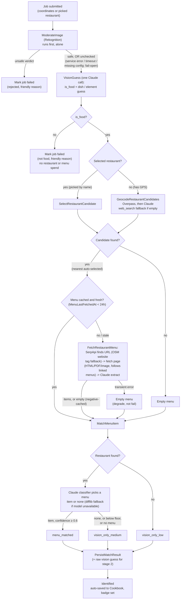

# Identify Pipeline (Stage 1)

How a scan goes from a photo to a saved, identified dish. This reflects the built system as of
2026-09-01, reconciled against the target flow drawn during design.

It is split into two views because the system is: an **interactive pre-submit** phase in the app,
then a **fire-and-forget pipeline** on the backend. The pipeline runs uninterrupted and the client
polls it, so it can never stop to prompt the user or loop for a retry. Anything interactive
(sourcing a location, re-shooting a non-food photo) happens before submit, in the frontend.

Stage 1 stops at `Identified`. Generating the recipe is stage 2 (`dish-recipe`), a separate
user-triggered execution.

## Pre-submit (frontend, interactive)

Resolves a location and a usable photo, then submits. Detail lives in `docs/user-flow.md`.

- **Live camera** uses device geolocation.
- **Uploaded photo** prefers the photo's EXIF GPS; if absent, the user searches by name
  (OSM Nominatim) and taps a restaurant.
- The submit always carries **either coordinates or an already-picked restaurant**, never a
  half-resolved state.
- A **not-food** result comes back from the pipeline as a friendly failed job; the user re-shoots
  and submits again. Re-shooting is an ordinary new submission, not a backend retry loop.

## Post-submit pipeline (backend, `dish-identify.asl.json`)

> A user can abort an in-flight scan (`POST /api/jobs/{id}/cancel`), giving a terminal
> `Cancelled` state that is kept distinct from `Failed`. Omitted from the diagram for clarity.

## Key behaviours

- **Moderation gates everything and fails open.** `ModerateImage` runs first and alone, so a
  rejected photo costs one Rekognition call and no model spend. An explicit unsafe verdict fails
  the job; a service error, timeout, missing config or exhausted quota is `unchecked` and allowed
  through, not failed.
- **One vision call is the food gate, and it runs before any restaurant or menu spend.**
  `VisionGuess` returns `is_food` plus the dish/element breakdown together; a `false` ends the job
  with a friendly reason before geocode or the paid menu fetch ever run, the same first-and-alone
  discipline as moderation one step up. It is sequential, not parallel with the menu branch, on
  purpose: a wasted paid menu fetch on a non-food photo is not worth the few seconds of overlap it
  would save on the happy path.
- **Restaurant selection auto-picks the nearest.** The candidate list is the geocode result
  (nearest first); `candidate_envelope` takes the top one. The full list is persisted, so a
  frontend override after the fact is possible; the pipeline never blocks on it. No restaurant
  found is a valid outcome, not an error.
- **Menu fetch is a deterministic SerpApi pipeline** (decision 2026-08-25): SerpApi finds the
  menu-page URL from name + address, the page is fetched (HTML, PDF or image, following linked
  menus when a page is just a shell), and one tool-free Claude call extracts structured items. The
  whole step is wall-clock bounded (`MENU_FETCH_BUDGET_SECONDS`). A clean "no menu online" is an
  empty list, cached as a negative so it is not re-searched each scan; a transient failure degrades
  to the vision-only medium outcome without caching.
- **The 24h cache gate** (`MENU_CACHE_TTL_HOURS`) keyed on restaurant identity means a chain's
  branches share one fetched menu. Accepted tradeoff: a branch with a genuinely different menu can
  mismatch.
- **The match is a Claude classifier plus a confidence floor.** The classifier is given the vision
  guess and the one restaurant's menu and picks the single best item or none, never inventing one
  (so the anti-hallucination property holds). A positive pick must clear
  `MENU_MATCH_CONFIDENCE_THRESHOLD` (default `0.6`) to count as `menu_matched`; below it, or a
  "none", degrades to `vision_only_medium`. The floor is deliberate defense in depth: a confident
  but wrong classifier pick is demoted to the honest "not sure" badge rather than shown as a match.
  A `difflib` character-similarity matcher stands in when the model is unconfigured.

## Three confidence outcomes

Recorded as `match_method` on the result (see `docs/api.md`):

- `menu_matched`: the vision guess cleared the floor against the restaurant's real, fetched menu.
- `vision_only_medium`: a restaurant was identified, but no menu was online or no item matched
  above the floor.
- `vision_only_low`: no restaurant identified at all.
