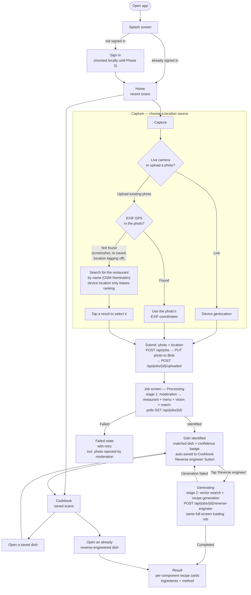

# User Flow

The end-to-end journey through the Replate app, from opening it to seeing a recreated
recipe. Two parts carry most of the decisions — the Capture step's location-sourcing branch
(live GPS vs. EXIF vs. manual search), and the split between identifying a dish and
reverse-engineering it. See `docs/decisions.md` for the reasoning behind each.

The headline shape: **snapping a photo identifies and saves the dish; generating the recipe
is a separate, deliberate action later.**

## Notes

- **Live capture** always uses device geolocation — a live camera frame has no EXIF to read.
- **Uploaded photo** prefers EXIF GPS (reflects where the photo was actually taken, which
  matters since the user may no longer be at the restaurant); only falls back to the manual
  search step when EXIF GPS is genuinely absent.
- **Manual search** never silently substitutes device location for the restaurant's
  location — device coordinates only bias which search results rank first. The user's tap is
  what actually sets the job's restaurant.
- **Auto-save** happens server-side the moment stage 1 finishes — there is no "save this?"
  prompt. Photographing a dish already implies wanting to keep it, so the old choice was
  friction with a foregone conclusion. The heart on a dish still removes it.
- **Reverse engineering is opt-in** because generating the method is the heaviest and most
  expensive call in the pipeline, and a user sitting in the restaurant doesn't need it yet.
  Stage 1 stops at `Identified`, and the recipe is generated only when the user opens the
  dish and asks. A cookbook card shows a "not yet reverse-engineered" badge until then.
- **Result confidence** comes from one of three outcomes computed server-side
  (`match_method` in the API response, see `docs/api.md`): `menu_matched` (the vision
  guess was cross-checked against the restaurant's real, fetched menu — the primary
  anti-hallucination signal), `vision_only_medium` (a restaurant was found but no menu item
  matched), or `vision_only_low` (no restaurant found at all). This badge now appears at the
  `Identified` stage, *before* any recipe exists — it is what makes a freshly-saved cookbook
  entry meaningful on its own.
- **A failed generation is not a failed job.** Stage 2 errors revert the dish to `Identified`
  with the error shown inline beside a working retry button, so a transient model error never
  throws away a good restaurant identification and menu match. `Failed` means stage 1 failed.
