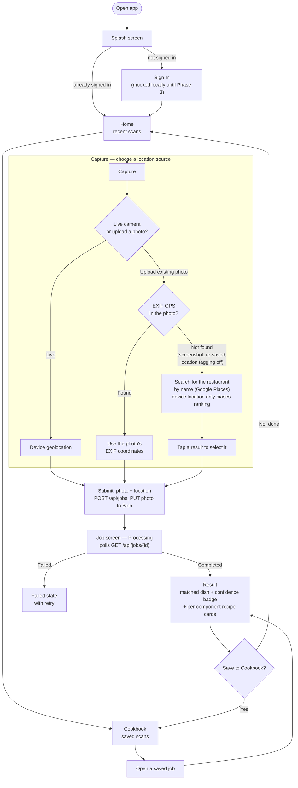

# User Flow

The end-to-end journey through the Replate app, from opening it to seeing a recreated
recipe. The Capture step's location-sourcing branch (live GPS vs. EXIF vs. manual search) is
the most decision-heavy part of the flow — see `docs/decisions.md` for the reasoning behind
each branch.

## Notes

- **Live capture** always uses device geolocation — a live camera frame has no EXIF to read.
- **Uploaded photo** prefers EXIF GPS (reflects where the photo was actually taken, which
  matters since the user may no longer be at the restaurant); only falls back to the manual
  search step when EXIF GPS is genuinely absent.
- **Manual search** never silently substitutes device location for the restaurant's
  location — device coordinates only bias which search results rank first. The user's tap is
  what actually sets the job's restaurant.
- **Result confidence** comes from one of three outcomes computed server-side
  (`match_method` in the API response, see `docs/api.md`): `menu_matched` (the vision
  guess was cross-checked against the restaurant's real, fetched menu — the primary
  anti-hallucination signal), `vision_only_medium` (a restaurant was found but no menu item
  matched), or `vision_only_low` (no restaurant found at all). The Result screen's confidence
  badge reflects whichever applies.
